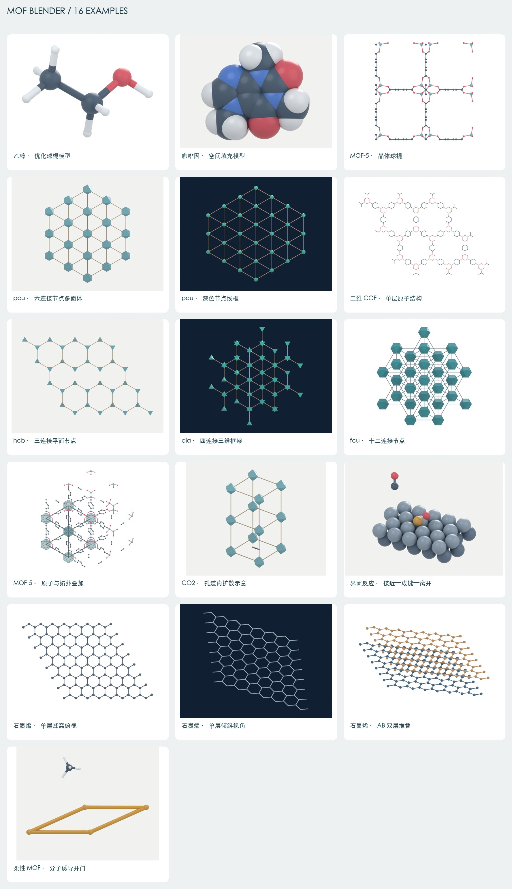

# MOF Blender

**从 CIF 拓扑分析、分子建模到 Blender 结构图与动态示意。**

[English](README.md) · [示例画廊](docs/gallery.md) · [方法与来源](docs/sources.md) · [验证记录](docs/validation.md)

MOF Blender 是一套可被不同 agent 共用的 Python 工具、MCP 服务与技能包。它连接
**AuToGraFS 拓扑分析、RDKit 分子优化和 Blender Cycles 渲染**，为 Codex、Claude Code
及其他支持 MCP 的 agent 提供统一接口。



## 已实现的能力

| 模块 | 功能 |
| --- | --- |
| CIF 检查 | 选择结构数据块，检查占位率和无序，展开晶体对称性，记录源文件 SHA-256 |
| MOF / COF 拓扑 | 调用 AuToGraFS，提取构筑单元、含周期平移的商图、候选拓扑、匹配层级与周期维度 |
| 拓扑抽象 | 在显示图中收缩二连接连接子；绘制节点线框、实际连接方向的凸包多面体、连接线 |
| 小分子建模 | SMILES / MOL / SDF / PDB 输入；ETKDG 多构象；MMFF94s 优先、UFF 回退；导出 SDF / XYZ |
| 原子模型 | 球棍、细棒、空间填充、拓扑模型、原子与透明多面体叠加 |
| 二维材料 | 理想石墨烯与 h-BN；AA / AB 堆叠；分层配色；CIF / XYZ 导出 |
| 自然语言视角 | 晶轴、直接晶格方向 `[uvw]`、晶面法向 `(hkl)`、笛卡尔向量、旋转、正交或透视 |
| 组合示意 | 按明确的位置、缩放比例和箭头组合多个分子、框架或表面场景 |
| 动态示意 | 分子沿指定孔道路径刚体移动；原子守恒的界面反应分镜及指定成键、断键；理想化铰接孔的开门过程 |
| 文件交付 | PNG、可编辑 `.blend`、场景 JSON、验证清单；动画另有 GIF 和逐帧 PNG |

这是一个**已经实现并测试的初版**。它有明确的化学与算法边界，不能把漂亮的结构图直接当作
拓扑唯一性、实验机理或动力学结论。

## 16 组示例，含 3 段示意动画

示例生成脚本提供 16 组示例，使用三套独立设计的材质与灯光：

- **paper**：白底、低饱和科学配色、大面积柔光。
- **porcelain**：浅中性背景、柔和陶瓷质感。
- **midnight**：深蓝底、青绿色节点、暖金色连接线。

| 编号 | 示例 |
| --- | --- |
| 01–02 | 乙醇的优化球棍模型；咖啡因的优化空间填充模型 |
| 03–05 | MOF-5 原子孔道图；六连接 `pcu` 多面体；深色节点线框 |
| 06–07 | 硼氧六环二维 COF 的原子层；三连接 `hcb` 三角节点 |
| 08–09 | 四连接 `dia` 四面体；十二连接 `fcu` 节点多面体 |
| 10 | MOF-5 原子结构与透明多面体叠加 |
| 11–12 | CO₂ 在孔道内移动；界面接近—成键—产物离开的动画分镜 |
| 13–15 | 单层石墨烯俯视、倾斜视角、AB 双层堆叠 |
| 16 | 优化后的甲烷进入理想化铰接孔；孔口由 24° 菱形展开为 90° 正方形 |

在[示例画廊](docs/gallery.md)中查看每一组图和说明。框架示例来自 AuToGraFS 生成模型，
不是用户上传的实验精修结构；三段动画是人为指定的示意过程，不是 MD 轨迹。开门示例单独
构造理想化孔道，不对上传的 CIF 做变形。小分子在放入场景前已经过 RDKit 力场优化。
运行渲染流程时会同时保留可编辑的 Blender 文件。

## 安装

### 环境要求

- Python **3.12+**；实际测试使用 Python 3.12。
- 独立安装 Blender；实际渲染测试环境是 **macOS arm64 + Blender 5.2.1 LTS**。
  代码面向 Blender 4.5+ 的 API，尚未在每一种版本或平台完整测试。
- 超胞应与可用内存匹配。当前原子场景上限为 25,000 个原子实例；更大结构建议使用拓扑模式。

使用 `uv` 安装：

```bash
git clone https://github.com/owenxyzhang-seseTJ/mof-blender.git
cd mof-blender
uv venv --python 3.12
uv pip install --python .venv/bin/python -r requirements.lock.txt
uv pip install --python .venv/bin/python --no-deps .
.venv/bin/python scripts/run.py doctor
```

也可以使用标准 Python 环境：

```bash
python3.12 -m venv .venv
.venv/bin/python -m pip install -r requirements.lock.txt
.venv/bin/python -m pip install --no-deps .
```

Windows 将 `.venv/bin/python` 替换为 `.venv\Scripts\python.exe`。
`requirements.lock.txt` 记录本次测试的精确依赖版本；不同平台的 wheel 可用性可能不同。
若无法使用完整锁定环境，可以通过 `pip install .` 按项目声明解析兼容依赖。

以上命令采用普通的非 editable 安装。源码启动器 `.venv/bin/python scripts/run.py ...`
直接加载当前检出目录的代码，每次启动都会使用最新修改，无需重新安装。若使用已安装的
`mof-blender` 或 `mof-blender-mcp` 入口，更新源码后应重新安装包：在上述 `uv pip install`
命令中增加 `--reinstall`，或在 `python -m pip install` 命令中增加 `--force-reinstall`。

化学库安装在项目环境中，不需要装入 Blender 自带的 Python。如果 Blender 不在标准路径，设置：

```bash
export BLENDER_PATH="/Applications/Blender.app/Contents/MacOS/Blender"
```

`doctor` 会检查科学库与 Blender 路径，不会把“已经找到程序”误报为“渲染已经完成”。

## 接入 Codex、Claude Code 和其他 agent

### Codex

使用实际的**绝对路径**注册 MCP：

```bash
codex mcp add mof-blender -- /absolute/mof-blender/.venv/bin/python /absolute/mof-blender/scripts/run.py mcp
```

将 `skills/mof-blender` 复制到 Codex 的技能目录，或者通过宿主的插件流程加载仓库中的
`.codex-plugin/plugin.json`。较长动画渲染建议设置 `tool_timeout_sec = 1800`；自动生成的
Codex TOML 已包含这个值。

### Claude Code

```bash
claude mcp add --scope user --transport stdio mof-blender -- /absolute/mof-blender/.venv/bin/python /absolute/mof-blender/scripts/run.py mcp
```

将技能目录复制到项目 `.claude/skills/`，即可作为项目技能使用。仓库也提供
`.claude-plugin/plugin.json`；若已安装的 `mof-blender-mcp` 可从 PATH 找到，根目录
`.mcp.json` 可用作插件的 MCP 默认配置。
若宿主无法继承虚拟环境的 PATH，请使用下方生成的绝对路径配置。

### Cursor、Windsurf、VS Code 等

先生成适配本机路径的配置片段：

```bash
.venv/bin/python scripts/configure_agents.py --output integrations/local
```

输出包括：

- `codex.toml`：Codex MCP 配置。
- `mcp.json`：采用 `mcpServers` 字段的 Claude / Cursor / Windsurf 等配置。
- `vscode-mcp.json`：采用 `servers` 字段的 VS Code 配置。
- `register-commands.txt`：Unix 类系统上的本机注册命令。

把适用片段合并到对应宿主配置中，再重启或重新加载宿主。生成脚本不会自动改动全局配置。
不要同时注册插件自带服务和同名手动服务。已验证真实 MCP 客户端的初始化、工具发现和调用；
尚未逐一在所有 agent 的 UI 中测试。

## 自然语言使用示例

可以直接对 agent 说：

> 分析这个 CIF 的拓扑。把节点画成多面体，连接子画成细线，生成 3×3×2 超胞，使用浅色陶瓷风格。

> 用 RDKit 优化乙醇，生成白底球棍图，并保留 SDF 和 XYZ。

> 沿 b 轴看，结构和配色不变，再向右旋转 30 度。

> 从 (1 0 0) 晶面的法向观察，改成正交投影。

> 画 AB 堆叠的双层石墨烯，用两种颜色区分层，并从斜上方看。

> 把优化后的 CO₂ 放到这个孔道内，沿给定路径移动，并说明这是示意动画。

> 优化甲烷，让它从理想化铰接孔口的左上方、孔口前侧接近，再沿孔道深度进入；同时让平面内
> 的菱形孔展开为正方形，保持框架杆长和客体内部几何不变。从 +Z 正对孔口观察，屏幕上方
> 为 +Y，并标注为示意动画。

相机工具直接识别一组常用中英文指令；更自由的表达由 agent 转为明确的方向、旋转和投影参数。
`[uvw]` 使用直接晶格，`(hkl)` 使用倒易晶格；对于非正交晶胞，两者一般不相同。
相机 `direction` 的约定是**从观察目标指向相机**。

## 命令行完整流程

运行 `.venv/bin/python scripts/run.py tools` 查看当前接口签名。推荐使用 JSON 参数文件，
避免复杂 shell 引号问题。CLI 同时接受短操作名及对应的 MCP 长名称别名，例如
`molecule` / `create_molecule_scene`、`view` / `set_view`、
`gate-open` / `create_gate_open_animation`、`render` / `render_figure`。

### CIF → 拓扑 → 场景 → 图片

准备 `analyze.json`：

```json
{
  "path": "examples/mof5_generated.cif",
  "output": "output/demo/mof5.analysis.json"
}
```

```bash
.venv/bin/python scripts/run.py call analyze --args-file analyze.json
```

准备 `scene.json`：

```json
{
  "analysis": "output/demo/mof5.analysis.json",
  "output": "output/demo/mof5.scene.json",
  "representation": "polyhedra",
  "repeat": [3, 3, 2],
  "preset": "porcelain",
  "view": "沿[1 1 0]看",
  "node_scale": 0.22,
  "edge_radius": 0.1,
  "width": 1600,
  "height": 1200,
  "transparent": false
}
```

```bash
.venv/bin/python scripts/run.py call scene --args-file scene.json
```

准备 `render.json`：

```json
{
  "scene": "output/demo/mof5.scene.json",
  "output_dir": "output/demo/render-v1",
  "samples": 128
}
```

```bash
.venv/bin/python scripts/run.py call render --args-file render.json
```

输出目录必须是新目录。其中包含 `render.png`、`scene.blend`、`scene.json`、
`blender_audit.json`、`blender.log` 和 `manifest.json`。只有所有必要产物存在，才会写入成功清单。
`.blend` 中包含可编辑对象、相机、材质、灯光，以及嵌入的场景 JSON。

### 其他常用操作

继续使用 `call 操作名 --args-file 参数文件`：

| 操作 | 主要参数 |
| --- | --- |
| `molecule` | `smiles` 或 `source`，`output`，`optimize=true`，`conformers=8`，`representation` |
| `layer` | `material="graphene"`，`repeat=[8,8,1]`，`layers=2`，`stacking="AB"` |
| `view` | `scene`，`output`，`instruction`；或 `direction` + `kind` |
| `compose` | 多个组件的场景、平移、缩放，以及可选箭头 |
| `diffusion` | 主体场景、客体分子场景、路径 `waypoints`、帧数、帧率 |
| `reaction` | 表面场景、显式原子与键的 `snapshots`、帧数、帧率 |
| `gate-open` | `guest_scene`、`output`、`frames=48`、`fps=12`、`closed_angle=24`、`open_angle=90`、`edge_length=6`、`depth=2.8` |
| `render` | 场景、输出目录、采样数；动画增加 `animate=true` 和足够超时时间 |

详见[动画参数与流程](skills/mof-blender/references/animations.md)。坐标单位为 Å。
帧率只控制展示速度，不代表真实动力学时间。

[完整开门配方](skills/mof-blender/references/animations.md#idealized-hinged-pore-gate-opening)
先通过 `molecule` 和 `smiles="C"` 优化甲烷，再生成开门动画，最后以 `animate=true` 渲染。
孔口位于 XY 平面，孔道深度沿 Z 轴。默认相机 `direction=[0,0,1]`、`up=[0,1,0]`，
即位于 +Z 一侧、朝 −Z 正对孔口，屏幕上方为 +Y。客体从孔口左上方和前侧接近，随后沿
深度进入；同时平面内的菱形孔展开为正方形，框架各杆长度与客体内部几何保持不变。

## MCP 工具清单

`environment_status`、`inspect_structure`、`analyze_framework`、`create_framework_scene`、
`create_molecule_scene`、`create_layer_scene`、`set_view`、`compose_schematic`、
`create_diffusion_animation`、`create_reaction_animation`、`create_gate_open_animation`、
`render_figure`。

每个工具提供参数模式。服务不接受任意 Python 或远程 shell 代码。科学库的普通输出被重定向，
避免污染 stdio MCP 协议。

## 数据与渲染架构

```text
自然语言 agent / JSON CLI
          │
          ├── CIF ── ASE + Gemmi ── AuToGraFS ── 分析 JSON
          ├── 小分子 ── RDKit 多构象 + MMFF94s / UFF
          └── 二维材料 ── ASE 蜂窝晶格 / 堆叠参数
                                  │
                             独立场景 JSON
                                  │
                     相机 / 组合 / 人为指定关键帧
                                  │
                       Blender 进程 + Cycles
                                  │
                     PNG / BLEND / GIF / 验证清单
```

周期边的整数平移是边身份的一部分。AuToGraFS 3.2.0 的 PyPI 版本与当前 GitHub 开发代码
字段不同，因此本项目针对已测试版本适配，并在生成节点几何前严格比较重新构造的商图。

二维显示会沿非周期方向选择连续的晶胞像；测试检查这一变换不改变键向量。切换视角只修改
相机，并检查几何哈希不变。原始 CIF、分子输入和已有输出文件均不静默覆盖。

## 科学边界与已知限制

- AuToGraFS 返回协调序列签名匹配的**候选拓扑**；匹配层级 `exact` 不是图同构或实验唯一性的证明。
- 无序与部分占位需要明确的有序模型；本工具不会悄悄修复、删原子或选择占位。
- 原子显示键采用共价半径距离阈值；CIF 键级不被推断。AuToGraFS 的分解使用另一套自身的键判据。
- 有限超胞保留显示端点之间的连接，边界可能出现截断片段；有限截图不等同于化学封端的纳米颗粒。
- 多面体依据连接方向构建，四连接可以是平面四边形或四面体。无限杆状 SBU 暂只报告，可画原子图，
  尚未实现其 PoE 多面体渲染。
- MMFF94s / UFF 对部分金属或特殊化学体系缺少参数；参数不完整或构象均不收敛会报错。
  力场能量不是自由能、吸附能或反应能垒。
- XYZ 没有键级，应设置 `optimize=false` 保持坐标，或提供 MOL / SDF / SMILES。
  PDB 的分子连接关系可能由 RDKit 感知。
- 孔道运动为刚体路径示意，不自动检查碰撞，不提供扩散系数；本版尚无完整 MD 轨迹导入器。
- 界面反应分镜保持原子身份，但不计算或证明过渡态、价态、电荷转移与机理。
- 开门动画采用理想化铰接孔、固定杆长和刚体客体，不对上传的 CIF 做变形，也不代表已经验证的
  材料机理、能垒或物理时间尺度。客体进入与孔口展开的配合由作者明确指定。
- 石墨烯与 h-BN 的晶格、层间距是明确记录的模型参数，生成层状结构时未做弛豫。
- 面向论文的图仍需结合具体结构、数据与用途进行科学审核。

## 测试与复现

```bash
.venv/bin/python -m pytest -q
.venv/bin/ruff check src scripts tests
.venv/bin/python scripts/create_examples.py --output output/my-gallery --render --animations --samples 64
```

使用新目录生成画廊；准备完成后，可用 `--resume` 跳过已成功渲染的目录。动画会逐帧渲染，
耗时比单元测试长。macOS 的严格沙箱可能阻止 Blender 初始化 Metal，即使使用 CPU 渲染也会
受到影响；这种情况下需要允许正常桌面权限下的渲染命令。

测试覆盖晶轴与晶面法向、周期连接子收缩、平面节点、二维边界展开、源文件不变、RDKit 收敛、
分子文件导出、反应原子守恒、真实 MCP 初始化与调用，以及 MOF / COF 的 AuToGraFS 集成测试。
实际版本和图片检查结果见[验证记录](docs/validation.md)。

## ChemBlender 参考、许可和引用

开发时查看了 ChemBlender 2.0 的结构导入、超胞、配位多面体、方向控制与渲染流程。
**没有复制或打包其源码、Geometry Nodes 库、资产、材质或默认渲染参数。** 本项目自行实现
中间场景格式、几何构建、三灯柔光与 agent 接口。详见[来源与实现说明](docs/sources.md)。

本项目代码采用 [MIT 许可](LICENSE)，依赖软件保留各自的许可证。研究使用时请引用底层科学
软件，尤其是 [AuToGraFS 原始论文](https://doi.org/10.1021/jp507643v)、
[RDKit](https://www.rdkit.org/)、[ASE](https://ase-lib.org/) 和 [Blender](https://www.blender.org/)。
